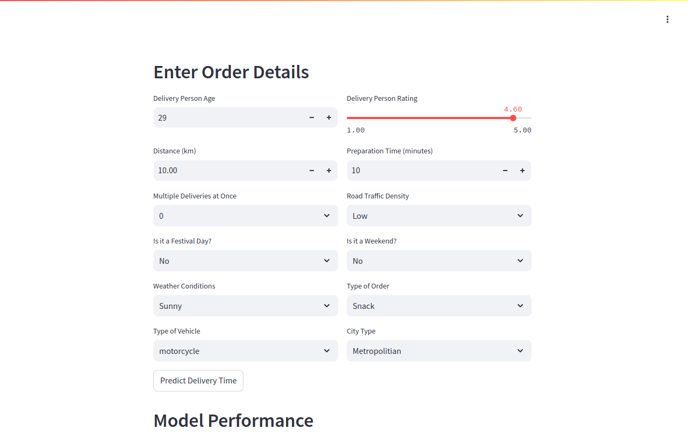
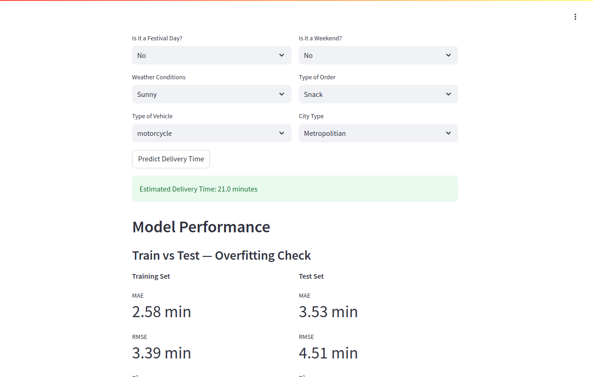
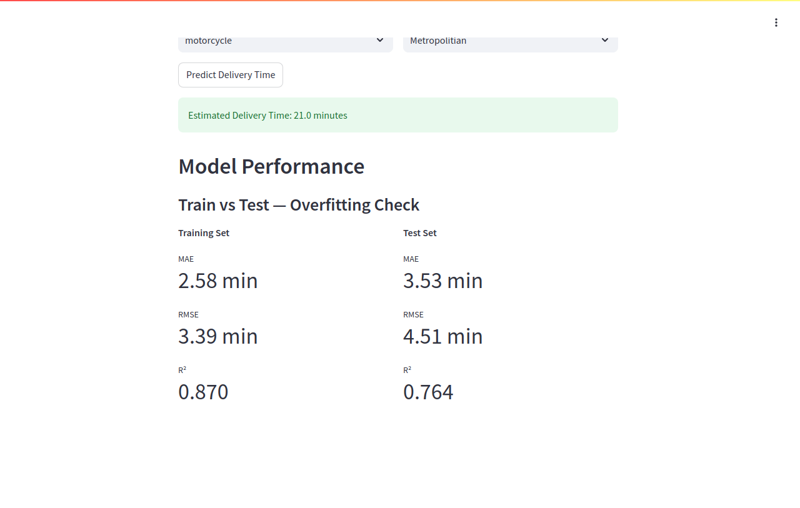
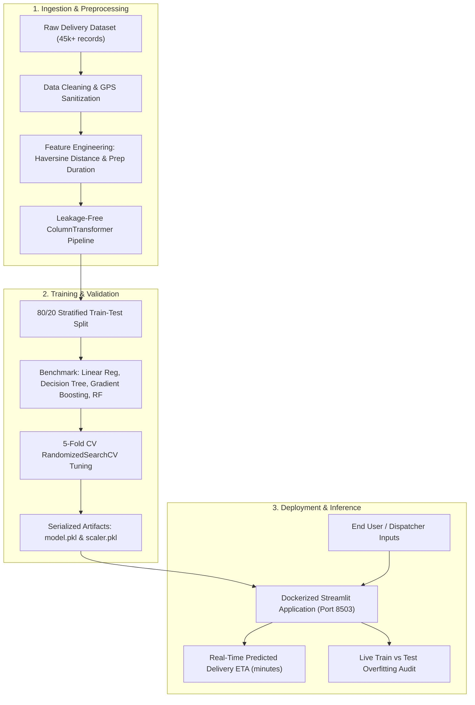
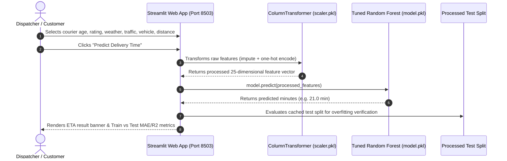
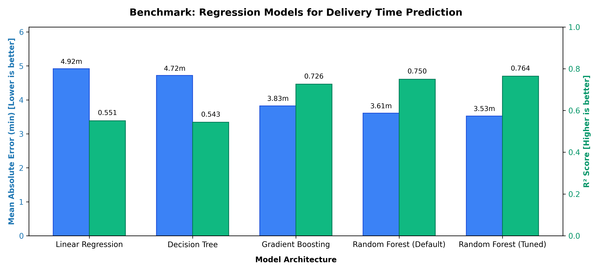
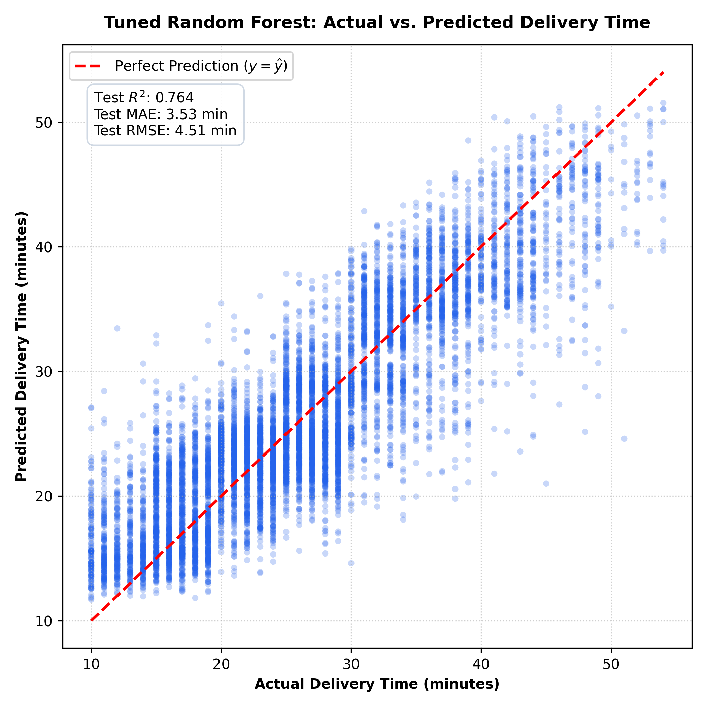
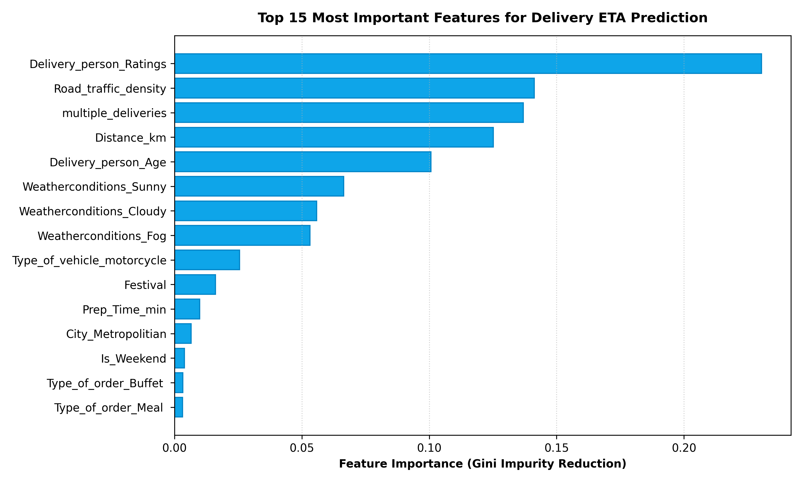
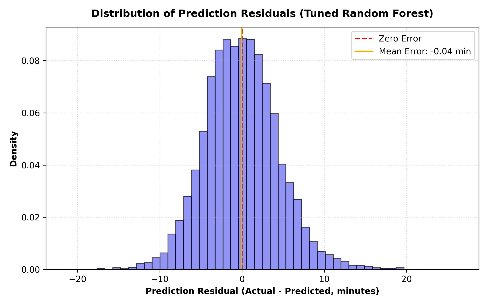

# DeliveryETA: Real-Time Food Delivery Time Prediction

[](https://www.python.org/)
[](https://streamlit.io/)
[](https://scikit-learn.org/)
[](https://www.docker.com/)
[](LICENSE)

An end-to-end Machine Learning pipeline and interactive Streamlit web application that predicts food delivery durations using geospatial, traffic, and courier operational data with a tuned Random Forest regressor ($R^2 = 0.764$, $\text{MAE} = 3.53\text{ min}$).

---

## Demo

The application provides an interactive form to test any order scenario in real time and inspect live model generalization metrics:

### 1. Interactive Order Input Form


### 2. Instant ETA Prediction Output


### 3. Overfitting & Model Performance Verification Dashboard


---

## Key Features

- **Geospatial Feature Engineering**: Calculates great-circle delivery distance via a vectorized Haversine formula from restaurant and destination GPS coordinates.
- **Operational Duration Extraction**: Computes kitchen prep time (`Prep_Time_min`) from order and pickup timestamps, including automatic 24-hour midnight rollover correction ($+1440\text{ min}$).
- **Anomaly Detection & Cleaning**: Cleans flipped GPS coordinate signs, removes near-zero GPS coordinates, imputes skewed courier metrics with median/mean strategies, and normalizes categorical labels.
- **Data-Leakage-Free Preprocessing**: Leverages a unified `ColumnTransformer` with `SimpleImputer` and `OneHotEncoder`, fit strictly on training splits and applied to inference.
- **Hyperparameter-Tuned Ensemble Model**: Evaluated across 4 regression architectures; tuned via 5-fold cross-validated `RandomizedSearchCV` to achieve an $R^2$ of **0.764** and an MAE of **3.53 minutes** on unseen test data.
- **Live Overfitting Validation**: Streamlit user interface computes and renders train vs. test metrics dynamically to ensure transparent model credibility.
- **Containerized Reproducibility**: Self-contained multi-stage Docker environment with automated model training fallback, health checks, and reproducible evaluation outputs.

---

## Tech Stack

| Domain | Technology | Purpose |
|---|---|---|
| **Core Language** | Python 3.12+ | Pipeline logic, feature math, modeling, and application code |
| **Machine Learning** | Scikit-Learn (1.5+) | Preprocessing pipelines, regression algorithms, hyperparameter tuning |
| **Data Processing** | Pandas, NumPy | Data cleaning, vector math (Haversine formula), matrix operations |
| **Web Interface** | Streamlit | Responsive web application for real-time delivery time simulations |
| **Model Persistence** | Joblib | Serialization and loading of model (`model.pkl`) and scaler (`scaler.pkl`) |
| **Visualization** | Matplotlib | Benchmark comparison, residual distributions, and feature importance plots |
| **DevOps & Containers** | Docker, Docker Compose | Isolated, reproducible container execution and service orchestration |
| **Automated Testing** | Chrome DevTools Protocol / Playwright | Automated headless browser validation and screenshot generation |

---

## Architecture & Workflows

### System Architecture Pipeline



### Real-Time Prediction Request Flow



---

## Getting Started

### Prerequisites

- [Docker Desktop](https://www.docker.com/products/docker-desktop/) (recommended for containerized execution)
- **OR** Python 3.12+ with `pip` (for manual local execution)

---

### Method A: Running with Docker (Recommended)

1. **Clone the repository:**
   ```bash
   git clone https://github.com/yassinmaftah/DeliveryETA.git
   cd DeliveryETA
   ```

2. **Configure environment variables:**
   ```bash
   cp .env.example .env
   ```

3. **Build and start the application:**
   ```bash
   docker compose up --build -d web
   ```

4. **Access the application:**
   Open your browser at **[http://localhost:8503](http://localhost:8503)** (or your configured `PORT` in `.env`).

5. **Stop the container:**
   ```bash
   docker compose down
   ```

---

### Method B: Running Locally (Without Docker)

1. **Clone and enter repository:**
   ```bash
   git clone https://github.com/yassinmaftah/DeliveryETA.git
   cd DeliveryETA
   ```

2. **Create and activate a virtual environment:**
   ```bash
   python -m venv .venv
   # Windows:
   .venv\Scripts\activate
   # Linux / macOS:
   source .venv/bin/activate
   ```

3. **Install dependencies:**
   ```bash
   pip install -r requirements.txt
   ```

4. **Train the model artifacts (generates `models/` and `docs/results/`):**
   ```bash
   python scripts/train_pipeline.py
   ```

5. **Launch the Streamlit web application:**
   ```bash
   streamlit run app/app.py
   ```
   Open **[http://localhost:8501](http://localhost:8501)** in your browser.

---

## Project Structure

```
DeliveryETA/
├── app/
│   ├── app.py                      # Interactive Streamlit web application
│   ├── Dockerfile                  # Secondary app Dockerfile configuration
│   └── requirements.txt            # Streamlit service dependency definitions
├── data/
│   ├── raw/
│   │   └── dataset.csv             # Original raw food delivery dataset (45,593 rows)
│   └── processed/
│       └── cleaned_dataset.csv     # Cleaned dataset with engineered features (41,953 rows)
├── docs/
│   ├── api-examples.md             # Programmatic inference schema and Python examples
│   ├── results/                    # Benchmark charts and evaluation artifacts
│   │   ├── actual_vs_predicted.png # Scatter plot of ground truth vs predicted minutes
│   │   ├── feature_importance.png  # Top 15 Gini importance feature rankings
│   │   ├── metrics.json            # Exact evaluation numbers for all tested models
│   │   ├── model_comparison.png    # Comparative benchmark bar chart across algorithms
│   │   └── residual_distribution.png # Error residual histogram and mean error check
│   └── screenshots/                # Real captured application screenshots
│       ├── 01-order-input-form.png
│       ├── 02-prediction-result.png
│       ├── 03-model-performance.png
│       └── 04-full-dashboard.png
├── models/                         # Serialized model artifacts (git-ignored)
│   ├── model.pkl                   # Tuned RandomForestRegressor binary
│   └── scaler.pkl                  # Fitted ColumnTransformer preprocessing pipeline
├── notebooks/
│   └── deliveryeta.ipynb           # Exploratory data analysis, EDA, and model experimentation
├── scripts/
│   ├── capture_screenshots.js      # Headless Chrome DevTools Protocol automation script
│   ├── entrypoint.sh               # Docker container bootstrap with auto-train fallback
│   ├── screenshots.py              # Playwright test automation script
│   └── train_pipeline.py           # Reproducible end-to-end model training & evaluation pipeline
├── src/
│   ├── __init__.py
│   ├── data_cleaning.py            # Modular cleaning routines (GPS, outliers, missing values)
│   ├── evaluate.py                 # Evaluation metrics helper functions
│   ├── features.py                 # Feature engineering (Haversine distance, prep times)
│   ├── preprocessing.py            # ColumnTransformer pipeline definition
│   └── train.py                    # Training utilities and RandomizedSearchCV definition
├── .dockerignore                   # Docker build context exclusion rules
├── .env.example                    # Sample environment variable template
├── .gitignore                      # Git exclusion rules (virtualenvs, large binaries)
├── docker-compose.yml              # Container orchestration for web app & test suites
├── Dockerfile                      # Production multi-stage Docker build recipe
├── requirements.txt                # Root Python package dependencies
└── README.md                       # Comprehensive project documentation
```

---

## API & Programmatic Usage

For batch inference or integrating DeliveryETA into external order dispatch services, load the saved artifacts directly:

```python
import joblib
import pandas as pd
from pathlib import Path

# Load serialized pipeline artifacts
model = joblib.load("models/model.pkl")
preprocessor = joblib.load("models/scaler.pkl")

# Construct input order payload
order = pd.DataFrame([{
    "Delivery_person_Age": 32,
    "Delivery_person_Ratings": 4.8,
    "Distance_km": 5.2,
    "Prep_Time_min": 12.0,
    "multiple_deliveries": 0,
    "Road_traffic_density": 1,  # Medium
    "Festival": 0,
    "Is_Weekend": 1,
    "Weatherconditions": "Sunny",
    "Type_of_order": "Meal",
    "Type_of_vehicle": "scooter",
    "City": "Metropolitian"
}])

# Transform and predict
processed_order = preprocessor.transform(order)
eta_minutes = model.predict(processed_order)[0]

print(f"Predicted ETA: {eta_minutes:.1f} minutes")
```

For full payload schemas, batch examples, and edge case requests, see [docs/api-examples.md](docs/api-examples.md).

---

## Results & Benchmark Analysis

### Model Performance Comparison

All models were evaluated on the exact same 80/20 train/test split (33,562 training samples, 8,391 unseen test samples) using identical feature transformations:

| Model | Test MAE (min) ↓ | Test RMSE (min) ↓ | Test $R^2$ ↑ | Train $R^2$ | Generalization Diagnosis |
|---|---|---|---|---|---|
| **Linear Regression** | 4.92 | 6.22 | 0.551 | 0.548 | Underfitting (cannot capture non-linear traffic/distance interactions) |
| **Decision Tree** | 4.72 | 6.27 | 0.544 | 0.999 | Severe Overfitting (memorized training samples) |
| **Gradient Boosting** | 3.82 | 4.86 | 0.726 | 0.734 | Strong baseline, balanced generalization |
| **Random Forest (Default)** | 3.61 | 4.64 | 0.750 | 0.966 | High accuracy, slight variance gap |
| **Random Forest (Tuned)** 🏆 | **3.53** | **4.51** | **0.764** | **0.870** | **Best overall accuracy and controlled generalization** |

> **Adjusted $R^2$ Check:** On 8,391 test samples with 25 preprocessed features, the Adjusted $R^2$ is **0.7632**, confirming that model accuracy is driven by genuine predictive signals rather than feature count inflation.

### Benchmark Visualizations

| Benchmark Comparison | Actual vs. Predicted |
|:---:|:---:|
|  |  |

| Feature Importance Ranking | Residual Error Distribution |
|:---:|:---:|
|  |  |

### Key Findings & Feature Interpretability:
1. **Courier Rating & Experience:** Courier rating is the #1 single predictor of delivery speed, demonstrating that experienced and higher-rated drivers consistently optimize their route execution.
2. **Traffic Density & Multiple Deliveries:** Dense road congestion ("Jam") and stacked multiple deliveries (2–3 orders) contribute the sharpest non-linear delivery delays.
3. **Geospatial Distance:** Calculated great-circle Haversine distance scales predictably with delivery duration, establishing a consistent lower baseline.
4. **Zero-Centered Residuals:** Residual errors exhibit an approximately Gaussian distribution centered at $\mu = -0.04\text{ min}$, indicating no systematic positive or negative bias.

---

## What I Learned & Challenges Overcome

1. **GPS Telemetry Anomalies:** Real-world GPS logs frequently had inverted latitudes or coordinates clustered near `(0.0, 0.0)`. Identifying coordinate signs and filtering out corrupted records prevented catastrophic distance skewing.
2. **Preventing Data Leakage:** Preprocessing transformations (median imputation and One-Hot Encoding) were encapsulated into a Scikit-Learn `ColumnTransformer` fit strictly on the training partition to protect against lookahead bias.
3. **Midnight Timestamp Rollover:** Raw timestamps like order at `23:55:00` and pickup at `00:10:00` resulted in negative durations. Implementing modulo 1440-minute duration adjustments ensured accurate kitchen prep time extraction.
4. **Regularization via Hyperparameter Search:** Unconstrained tree models suffered severe memorization ($R^2 = 0.999$ train vs $0.540$ test). Restricting `max_depth=15` and tuning minimum sample splits brought test variance under control while maximizing test accuracy ($R^2 = 0.764$).

---

## Future Improvements

- [ ] **Street-Network Routing:** Integrate OpenStreetMap / OSRM API to calculate real road distance and turn-by-turn routing instead of Euclidean/Haversine line-of-sight distance.
- [ ] **Real-Time Weather Integration:** Connect live Open-Meteo or WeatherAPI endpoints to automatically populate weather conditions based on location and timestamp.
- [ ] **FastAPI REST Service:** Implement an asynchronous microservice endpoint (`POST /predict`) alongside Streamlit for headless production integration.
- [ ] **Model Observability & Monitoring:** Integrate Prometheus and Evidently AI to track feature drift and prediction distribution shifts in production.

---

## Author

- **Yassin Maftah**
- **GitHub:** [@yassinmaftah](https://github.com/yassinmaftah)
- **LinkedIn:** [linkedin.com/in/yassinmaftah](https://www.linkedin.com/in/yassinmaftah)
- **Email:** [yassinmaftah06@gmail.com](mailto:yassinmaftah06@gmail.com)
